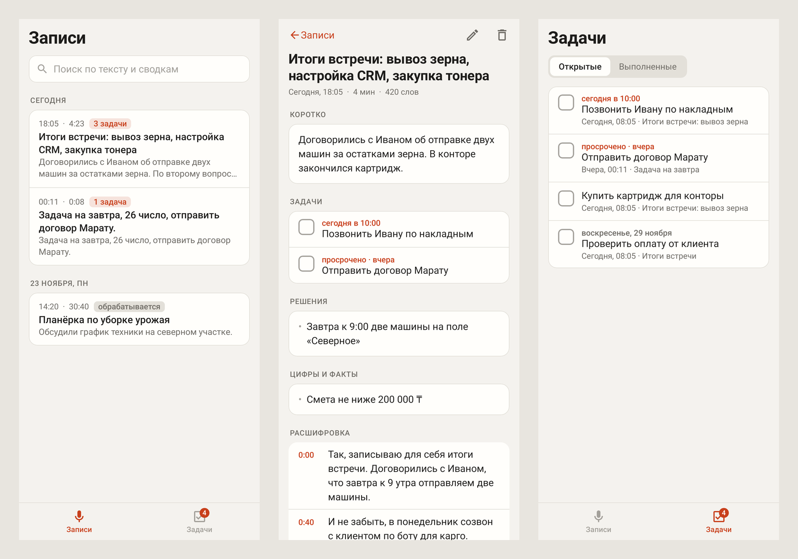

# AI-диктофон на часах

Свой Plaud без отдельного устройства и подписки. Жмёшь кнопку на часах с Wear OS и говоришь. Через минуту в телефоне готовы расшифровка, короткая сводка и задачи со сроками, а к нужному времени приходит напоминание на телефон и на часы, с кнопкой «Сделано».

<p align="center"></p>

```
[часы Wear OS] ──OGG/Opus──▶ [сервер: FastAPI + SQLite] ──▶ распознавание (OpenAI / faster-whisper)
                                         │                        │
                                         │                        ▼
                                         │              сводка и задачи (Claude / GPT)
                                         ▼                        │
                       [телефон: Android-приложение] ◀────────────┴──▶ [Telegram]
```

## Что умеет

- **Часы.** Запись по кнопке или плитке, работает с выключенным экраном. Без сети записи копятся на часах и отправляются, когда связь появится.
- **Распознавание.** OpenAI `gpt-4o-transcribe` (или любой OpenAI-совместимый API, или faster-whisper на своём CPU). Длинные записи режутся на куски, у текста появляются таймкоды. Перед распознаванием звук усиливается и чистится от шума: микрофон у часов тихий.
- **Словарь.** Имена, названия и термины из `data/slovar.txt` подсказывают распознаванию и выделению задач. Без словаря «соевый шрот» превращается в «условия маршрута».
- **Сводка.** Тема, коротко, решения, цифры и факты, открытые вопросы. Делает Claude или GPT.
- **Задачи со сроками.** «Завтра в 11 позвонить Ивану» превращается в задачу на завтра, 11:00. Ответ модели проверяется в коде: дата, время, дубли.
- **Напоминания.** Ко времени задачи и утренняя сводка в 9:00. Приходят в приложение на телефоне (локальные будильники, работают без сети) и в Telegram.
- **Приложение на телефон** (Kotlin, Jetpack Compose): записи с поиском, плеер с перемоткой по абзацам расшифровки, задачи с галочками. Светлая и тёмная тема.
- **Веб-архив** (PWA) на том же домене, если удобнее из браузера.
- **Совещания** пишутся так же: после встречи приходит сводка и полная расшифровка.

| Папка | Что внутри |
| --- | --- |
| `server/` | бэкенд на Python/FastAPI: приём записей, очередь, распознавание, сводка, задачи, напоминания, веб-архив |
| `wear/` | приложение для часов (Kotlin): кнопка, плитка, фоновая запись, очередь отправки |
| `phone/` | приложение для телефона (Kotlin, Compose): записи, плеер, задачи, уведомления |
| `docker-compose.yml` | сервер за Traefik с HTTPS |

## 1. Сервер

Нужен VPS с Docker и Traefik (Let's Encrypt), домен и ключи: OpenAI для распознавания, Anthropic или OpenAI для сводки, бот в Telegram (по желанию).

```bash
git clone https://github.com/Damirdzhama21/ai-watch-dictaphone && cd ai-watch-dictaphone
cp .env.example .env
openssl rand -hex 24      # -> UPLOAD_TOKEN
openssl rand -hex 32      # -> WEB_SECRET
nano .env                 # REC_DOMAIN, ключи API, WEB_PASSWORD, Telegram, параметры Traefik
mkdir -p data && cp slovar.example.txt data/slovar.txt   # свои имена и термины
docker compose up -d --build
curl https://rec.example.com/health     # {"ok":true,...}
```

- A-запись домена должна смотреть на VPS. Сертификат выпустит Traefik.
- Сеть, entrypoint и certresolver Traefik задаются в `.env`.
- `TG_CHAT_ID` можно узнать у @userinfobot. Чтобы бот мог писать, отправь ему `/start`.
- Словарь читается при каждой записи, перезапуск после правки не нужен.

### Сколько стоит

На OpenAI `gpt-4o-transcribe` уходит около $0,36 за час записи. Сводка и задачи через Claude стоят несколько центов за запись. Режим `STT_MODE=local` (faster-whisper) бесплатный, но медленный на CPU и хуже узнаёт имена.

## 2. Приложение для часов

Сборка: Android Studio → Open → `wear` → Build APK, или из консоли:

```bash
cd wear
./gradlew assembleRelease -PSERVER_URL=https://rec.example.com/rec -PUPLOAD_TOKEN=<тот же, что в .env>
```

Чтобы подписать своим ключом, добавь `-PKEYSTORE_PATH=… -PKEYSTORE_PASS=… -PKEY_ALIAS=… -PKEY_PASS=…`. Те же параметры можно положить в `wear/local.properties`.

Токен загрузки вшивается в APK. Не выкладывай собранный APK в открытый доступ.

### Установка на часы по Wi-Fi

1. На часах: Настройки → Система → О часах → 7 раз нажать «Номер сборки».
2. «Для разработчиков» → включить «Отладка по ADB» и «Отладка по Wi-Fi». Часы и компьютер должны быть в одной сети.
3. «Отладка по Wi-Fi» → «Подключить устройство с кодом». На компьютере ([platform-tools](https://developer.android.com/tools/releases/platform-tools)):
   ```bash
   adb pair 192.168.1.50:41235      # IP:порт и код из окна сопряжения
   adb connect 192.168.1.50:39517   # IP:порт с главного экрана отладки (другой порт)
   adb install -r app-release.apk
   ```
4. Открыть «Диктофон» на часах, разрешить микрофон и уведомления. Запись начинается сразу при открытии. Ещё есть плитка «Запись».

Проверено на OnePlus Watch 3 (Wear OS 5). Должно работать на Wear OS 3 и новее.

## 3. Приложение для телефона

```bash
cd phone
./gradlew assembleRelease -PSERVER_BASE=https://rec.example.com
```

Установи APK на телефон и войди с паролем `WEB_PASSWORD`. Приложение попросит разрешение на уведомления.

Чтобы ссылки на записи из Telegram открывались сразу в приложении, впиши в `.env` сервера `ANDROID_CERT_SHA256`: это отпечаток ключа, которым подписан APK (`apksigner verify --print-certs app-release.apk`).

Тесты и скриншоты экранов без устройства:

```bash
./gradlew testDebugUnitTest            # логика сроков, сводки, будильников + рендер экранов
./gradlew recordRoborazziDebug         # PNG в app/build/shots/
```

## 4. Что надо знать

- **Микрофон часов** рассчитан на голос рядом с ними. Для заметок его хватает с запасом. На совещании лучше держать руку поближе к говорящим или положить часы на стол. Приложение пишет в режиме голосовой связи, с автоусилением и шумодавом, а сервер дополнительно выравнивает громкость.
- **Напоминания на телефоне** ставятся будильниками и приходят точно. Уведомление «новая запись готова» приложение проверяет раз в 15 минут (ограничение Android без Firebase). В Telegram оно приходит сразу.
- **Время.** Сервер и приложение считают время по Алматы (UTC+5). Для другого пояса поправь `ALMATY` в `server/app/zadachi.py` и `Vremya.ALMATY` в приложении.

| Симптом | Что проверить |
| --- | --- |
| На часах «В очереди: N» не уменьшается | `curl …/health`, `docker compose logs watchrec`, токен в APK совпадает с `UPLOAD_TOKEN` |
| 401 в логах сервера | разные `UPLOAD_TOKEN` у сервера и в APK |
| В Telegram пусто | `TG_BOT_TOKEN`, `TG_CHAT_ID`, отправить боту `/start` |
| «Речь не распознана» | запись тихая или из кармана, проверь, не закрыт ли микрофон рукавом |
| Путает имена и термины | добавь их в `data/slovar.txt` |

## Лицензия

MIT
